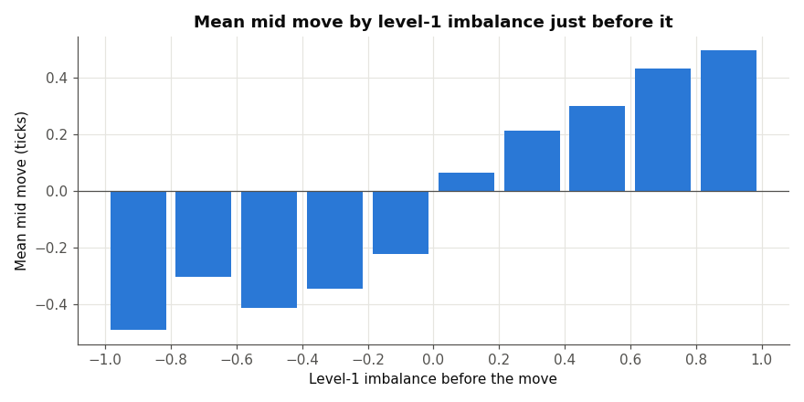
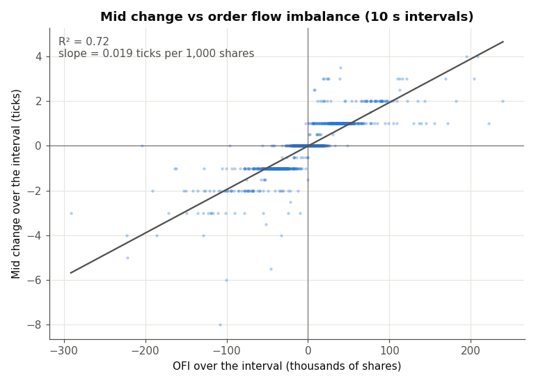

# orderbook-execution-sim

A limit order book and event-driven execution simulator in C++, built on NASDAQ order-level data (LOBSTER).
The end goal is to compare an adaptive execution strategy (passive vs aggressive, driven by fill probability,
order book imbalance and adverse selection) against a TWAP benchmark.

## Status

| Part | Content | Status |
| --- | --- | --- |
| 1 | Data: parsing, LOBSTER conversion, tests | Done |
| 2 | Order book (price levels, FIFO queues, O(1) cancel), invariant checker, full-day replay | Done |
| 3 | Microstructure indicators (spread, imbalance, queue position, EWMAs of returns, spread, depth and message intensity, OFI) | Done |
| 4 | Event-driven engine with latency and simulated fills | In progress |
| 5 | Execution strategy vs TWAP (fill model, markouts, implementation shortfall) | Planned |
| 6 | Performance measurement and optimisation | Planned |

80 unit tests (GoogleTest), all passing.

## Data

The project uses the free LOBSTER sample for **MSFT on 21 June 2012** (level 10), available at
[lobsterdata.com](https://lobsterdata.com/info/DataSamples.php). The data is not included in this repository:
download it and place the message file in `Data/`.

MSFT was chosen because it behaves as a **large-tick** stock (one-tick spread most of the time, long queues),
which makes it a good equity analogue of government bond futures such as the Bund.

## Message format

LOBSTER messages are converted once into the project's own format, which is the only format the rest of the
code reads:

```
timestamp,type,order_id,side,price,quantity
13994120,A,16116348,S,3105,100
20823678,C,16116815,,,
```

- `timestamp`: nanoseconds since 9:30
- `type`: `A` add, `C` cancel, `E` execute, `M` modify (new remaining quantity)
- `price`: integer ticks of $0.01
- unused fields are left empty

## Part 1 results (full MSFT day)

| | Lines |
| --- | ---: |
| Read | 668,765 |
| Written | 663,288 |
| of which `A` / `C` / `E` / `M` | 329,566 / 298,821 / 29,393 / 5,508 |
| Skipped: events on orders placed before 9:30, hidden executions, cross trades and trading halts | 5,477 |

A timestamp-order check on the converted file found 3 LOBSTER timestamps with 12-digit fractions
(floating-point printing artifacts in the source file). Fractions are now truncated to 9 digits
(error ≤ 1 ns), and the converted file has no backward timestamps.

## Part 2: the order book

The book **mirrors** the exchange feed: it applies each message (add, cancel, execute, modify) and never matches
orders itself.

- **Price levels:** `std::map` per side, bids sorted in descending order, so the best price is always `begin()`.
- **FIFO queue per level:** `std::list`, so cancelling an order anywhere in the queue is O(1) and iterators stay valid.
- **Index by order ID:** `std::unordered_map` from ID to (side, price, iterator), giving O(1) average cancel,
  execute and modify.
- **Validation before mutation:** every message is checked first (unknown or duplicate ID, invalid side, price or
  quantity, execution larger than the order). A rejected message leaves the book unchanged and returns a status.
- **Modify:** a decrease keeps queue priority; an increase moves the order to the back of its queue.

### Data inconsistency: stale orders

About 2% of the orders added in the LOBSTER message file are never removed by any later message, although
LOBSTER's own book snapshots show them gone. Replaying messages only, these stale orders eventually cross the book.
**Uncross rule:** when a new order reaches the opposite side, the stale opposite levels it crosses are removed.

### Results (full MSFT day)

| | |
| --- | ---: |
| Messages replayed | 663,288 |
| Stale orders removed by the uncross rule | 2,645 |
| Crossed books after the rule | 0 |
| Invariant checks (every 10,000 messages + end of day) | 67, no violation |

The invariant checker verifies five rules: no empty level, each level's total equals the sum of its queue, each
level's price equals its key, the index and the queues agree exactly, and the book is never crossed.

Known limit: stale orders that are never crossed stay in the book. Part 4 will measure their effect.

Design choices are recorded in [DECISIONS.md](DECISIONS.md), known limits in [TODO.md](TODO.md).

## Part 3: microstructure indicators

An `Indicators` class reads the book by const reference after each message and writes one CSV row per message
(`Data/indicators_msft.csv`). Every indicator is updated in O(1) per message, with no stored history.
Figures are produced by `python/part3_figures.py` (saved in `figures/`); the hit rates, the depth average and the
EWMA cross-check by `python/part3_checks.py`.

### Spread and mid

| Spread | Share of messages | Share of time |
| --- | ---: | ---: |
| 1 tick | 80.3% | 99.2% |
| 2 ticks | 19.6% | 0.8% |
| 3 to 16 ticks | 0.03% | 0.02% |

The spread is one tick almost all the time. Two-tick states are brief but generate a fifth of all messages, so
statistics must be **time-weighted**: counting by message overstates the average spread by 19%
(1.197 ticks vs 1.008 ticks weighted by time). The mid changes 3,784 times over the day (0.6% of messages).

### Order book imbalance

- **One message before a mid move**, level-1 imbalance almost determines its direction: P(up) goes from 2% to 99%
  across imbalance buckets, and 47% of moves happen with |imbalance| > 0.8. This is largely mechanical: just before
  the move, the best queue on one side is nearly empty.
- **Further ahead**, the signal is what matters for prediction. Hit rate (sign of the imbalance = sign of the next
  mid move; moves where the imbalance is exactly 0 are excluded), level 1 vs 5 levels:

| Horizon before the move | 1 message | 10 ms | 100 ms | 1 s |
| --- | ---: | ---: | ---: | ---: |
| Level-1 imbalance | 0.854 | 0.781 | 0.724 | 0.664 |
| 5-level imbalance | 0.636 | 0.591 | 0.571 | 0.545 |

Level-1 imbalance stays clearly informative one second ahead (0.66, against 0.50 for a coin flip), and beats the
5-level imbalance at every horizon.



### Queue position

- `queueAhead(id)`: exact quantity ahead of an order in its queue (walks the queue, used as the reference).
- `QueueTracker`: follows chosen orders incrementally in O(tracked orders) per message, using an arrival ticket per
  order to decide ahead or behind without walking the queue. It is needed because the strategy's own simulated
  orders (Part 4) are never in the book.
- Full-day check in `replay`: 1 add in 1,000 is tracked and compared with `queueAhead` after every message:
  990,817 comparisons, 0 mismatches. 7 unit tests cover each update rule.

### EWMA indicators

The spread, depth and message-intensity EWMAs are the liquidity-regime indicators used later to split results
by market conditions.

| Indicator | Weighting | Full-day check |
| --- | --- | --- |
| Mean and variance of mid returns | per mid change, α = 0.05 | vol ≈ 0.5 tick per mid change |
| Spread | time-weighted, τ = 1 s | 1.0082 ticks vs exact time-weighted 1.0083 |
| Depth at best (bid + ask) | time-weighted, τ = 1 s | — |
| Message intensity | time-weighted, τ = 1 s | 28.3 messages/s on average; correlation 0.956 with an exact 1 s count |

The return, spread and intensity EWMA columns were recomputed independently in Python, row by row, from the CSV: the largest relative difference
is 5e-6, which is the CSV's 6-digit rounding.

Vol per mid change stays close to 0.5 tick all day: on a large-tick stock most mid moves are half-tick moves (95%
of them on this day), so
the information is in **how often** the mid moves rather than by how much.

### Order flow imbalance

Level-1 order flow imbalance (Cont, Kukanov & Stoikov, 2014), summed over fixed time intervals and regressed on the
mid change over the same interval:

| Interval | Intervals | Slope | R² |
| --- | ---: | ---: | ---: |
| 1 s | 23,399 | 1 tick per 51,800 shares | 0.67 |
| 10 s | 2,339 | 1 tick per 51,400 shares | 0.72 |
| 60 s | 389 | 1 tick per 48,200 shares | 0.83 |

The slope is stable across intervals. In the stylized model of the paper, the mid moves by 1/(2D) ticks per share,
where D is the average depth at the best price on one side. Here D ≈ 12,150 shares (time-weighted over the day), so
that model predicts 1 tick per 24,300 shares: the measured impact has the same order of magnitude but is about half
the stylized prediction.



## Build and run

Requires CMake ≥ 3.20 and a C++20 compiler. GoogleTest is downloaded automatically by CMake.

```
cmake -S . -B build -DCMAKE_BUILD_TYPE=Release
cmake --build build
./build/tests
./build/converter    # LOBSTER message file -> Data/converted_book_lobster.csv
./build/replay       # replays the book, checks invariants, writes Data/indicators_msft.csv
```

Figures (Python 3 with pandas, numpy and matplotlib), from the `python/` folder:

```
python part3_figures.py   # figures, spread and intensity checks, OFI regressions
python part3_checks.py    # imbalance hit rates, average depth, row-by-row EWMA cross-check
```

Run the programs from the project root, so the relative paths to `Data/` resolve.

## Disclosure: use of AI

This project is also how I am learning C++, and I used Claude (Anthropic) as a tutor throughout.

- **Project design:** the project plan and a step-by-step learning guide (concepts, tasks and hints for each question) were prepared with Claude.
- **Workflow:** for each task, Claude points me to the relevant sections of learncpp.com and cppreference.com. After reading them, I design and write my own solution, then send it to Claude for review; it points out potential bugs, which I then fix myself.
- **Code:** the large majority of the C++ code was written by me: parsing, LOBSTER conversion, the order book,
  the invariant checker, the replay, the indicators (spread, imbalance, EWMAs of returns, spread, depth and message intensity, OFI), the exact
  queue position and the `QueueTracker`. Claude provided a few pieces: mainly the `parseInt` helper based on
  `std::from_chars`, a first example test for `fitOrderEvent` used as a template for the others, part of `print`
  formatting of the book, part of the order book unit tests (modify, apply and the uncross rule), the
  `CMakeLists.txt` configuration and this README.
  - Once the testing pattern was established, I had Claude generate the repetitive Indicators and QueueTracker
    test cases, which I reviewed.
  - The Python plotting and check scripts were written by Claude; the analysis and the conclusions drawn from them
    are mine.

Every design choice and its reason is recorded in [DECISIONS.md](DECISIONS.md).